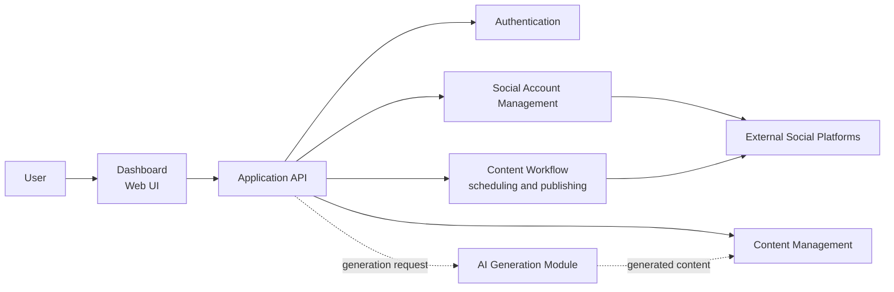
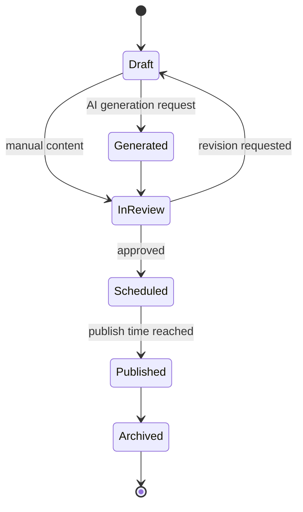
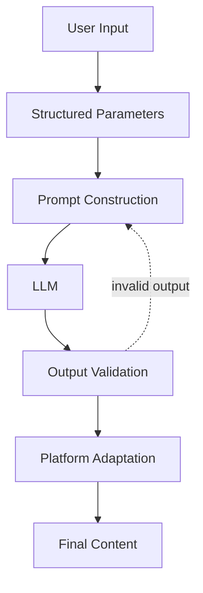
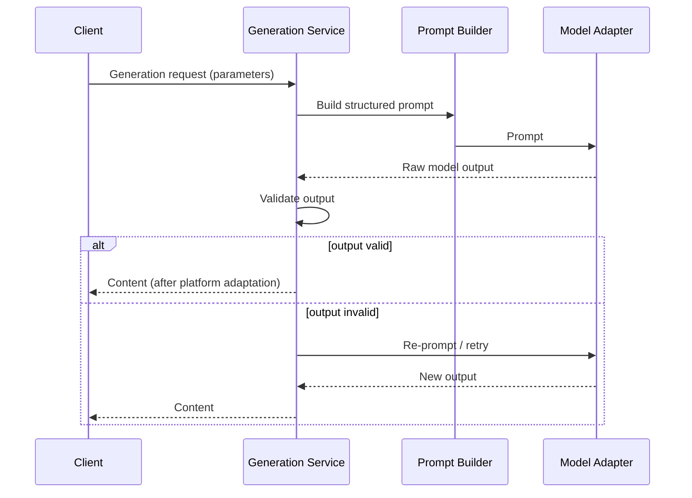
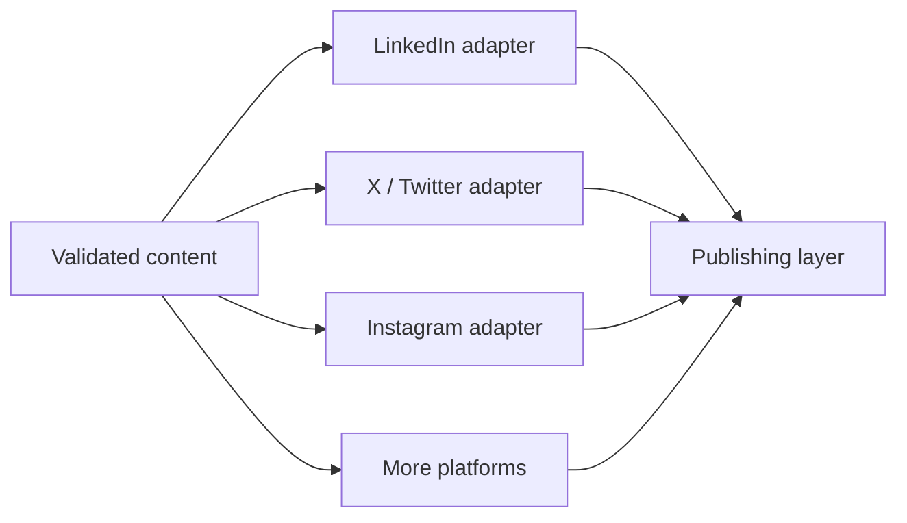

# Nexora

**AI-Powered Social Media Management Platform**

> **Repository Notice:** This repository contains architectural documentation only. The original application source code, private configuration, credentials, and proprietary prompts are not publicly distributed.

## Overview

Nexora is an AI-powered social media management platform designed to centralize social-media account management and automate content-generation workflows.

The system combines conventional web-application architecture with generative AI, allowing users to manage multiple accounts and generate customized content using large language models.

## Objectives

- Centralize multiple social-media accounts in one dashboard.
- Manage the full content lifecycle from draft to published.
- Generate content with LLMs from structured user requirements.
- Adapt content to different platforms.
- Control tone, audience, and objective of generated content.
- Separate AI functionality from conventional business logic.
- Provide a scalable architecture for additional social platforms.

## Architecture

## Core Components

### User Interface

Provides the dashboard through which users manage accounts, content, and schedules.

### Authentication

Handles user identity and protected application functionality.

### Social Account Management

Maintains the relationship between users and the social-media accounts they manage, including connection status, permissions, and platform mapping.

### Content Management

Stores and organizes generated or manually created content, together with metadata such as target platform, status, and author.

### Content Workflow

Coordinates the lifecycle of each content item: generation, review, scheduling, and publishing to connected accounts.

### AI Generation Module

Responsible for producing content from structured user requirements. The application layer remains responsible for validating and organizing the generated result.

## Content Lifecycle

## AI Content Generation

### Generation Parameters

The user can conceptually specify:

| Parameter | Purpose |
|---|---|
| Topic | Subject of the content |
| Audience | Target readership |
| Platform | Destination platform |
| Tone | Voice and style |
| Objective | Goal of the post |
| Keywords | Terms to include |
| Format | Post shape / structure |
| Length | Approximate size |

### Generation Pipeline

### Model-Provider Abstraction

A model abstraction layer separates the generation service from any specific LLM provider, so the underlying model can be replaced without changing business logic:

## Platform Adaptation

A major design consideration is that different social platforms have different communication styles and constraints (length limits, media formats, tone conventions). Content is adapted per target platform before publishing:

The platform-adaptation layer allows the system to evolve as additional platforms are added.

## Design Principles

- Modular AI integration
- Separation of business logic and AI logic
- Extensible platform integration
- Centralized content management
- Reusable generation workflows
- Model-provider abstraction
- Output validation before delivery

## Technology Stack

| Category | Technology |
|---|---|
| Frontend | Web application dashboard |
| API | REST |
| AI | LLM-backed generation module |
| Integration | Social-media platform APIs |
| Authentication | Token-based authentication |
| Storage | Database-backed content and account store |

## Key Concepts

- Generative AI and LLM integration
- Prompt engineering
- Web applications and REST APIs
- Social-media APIs
- Content lifecycle management
- Workflow automation
- Output validation
- Platform-specific formatting
- Authentication
- Modular AI boundaries

## Limitations

- Generated content may require human review before publishing.
- Output quality depends on prompt construction and the underlying model.
- The public documentation does not include private API credentials, social-account access tokens, source code, or proprietary prompts.
